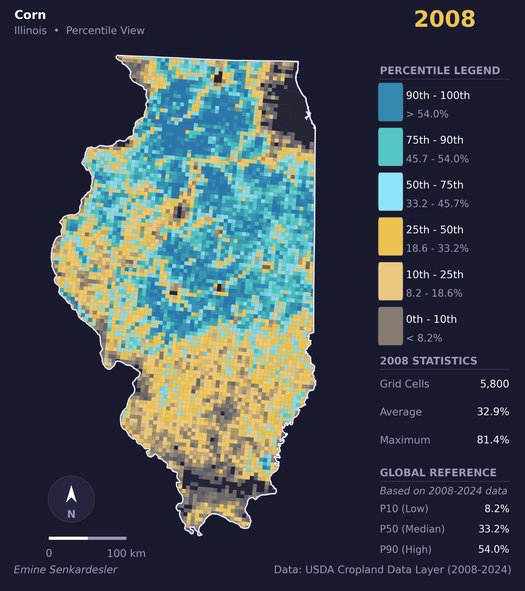
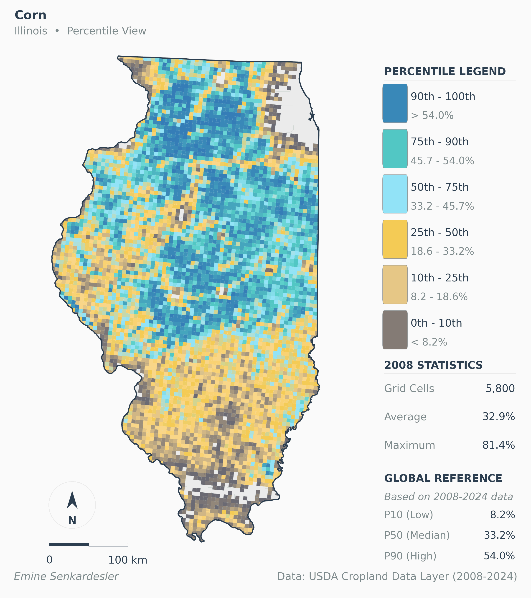

# Where Illinois grows its crops, 2008 to 2024

Animated maps of Illinois that show, year by year, where corn, soybeans, winter wheat and double crop are grown.

  
  

## What the gifs show

- **One frame per year.** Each gif has 17 frames, one for each year from 2008 to 2024.
- **The map is a 5 km grid.** Illinois is divided into square cells of 5 km. For each cell and year, the map uses the share of the cell planted with the crop, taken from the USDA Cropland Data Layer.
- **Colour is a ranking, not a raw share.** A cell's colour shows where its share ranks among all cells and all years for that crop. Blue cells are in the top 10% of the whole 2008 to 2024 period, grey cells are in the bottom 10%. Because the ranking uses all years together, the colours mean the same thing in every frame, so a cell that turns from yellow to blue really did gain crop area.
- **Empty cells.** Cells where the crop covers less than 0.5% of the area are left blank.

## How to read the side panel

| Part | What it tells you |
| --- | --- |
| Percentile legend | The six colour bands and the crop share (in %) that each band covers |
| Year statistics | For that year: how many cells have the crop, the average share and the highest share |
| Global reference | The low (10th percentile), median and high (90th percentile) share over the whole 2008 to 2024 period |

## The gifs

The dark and light versions show the same data with the same colours. Only the background differs.

| Crop | Dark theme | Light theme |
| --- | --- | --- |
| Corn | [gif](dark_theme/1_corn_illinois_dramatic.gif) | [gif](light_theme/1_corn_illinois_light.gif) |
| Soybeans | [gif](dark_theme/5_soy_illinois_dramatic.gif) | [gif](light_theme/5_soy_illinois_light.gif) |
| Winter wheat | [gif](dark_theme/24_winter_wheat_illinois_dramatic.gif) | [gif](light_theme/24_winter_wheat_illinois_light.gif) |
| Double crop (winter wheat then soybeans) | [gif](dark_theme/26_dbl_illinois_dramatic.gif) | [gif](light_theme/26_dbl_illinois_light.gif) |

The numbers at the start of the file names (1, 5, 24, 26) are the crop codes used in the Cropland Data Layer.

## Data source

USDA National Agricultural Statistics Service, Cropland Data Layer, 2008 to 2024.

## Author

Emine Senkardesler, University of Illinois Urbana-Champaign
